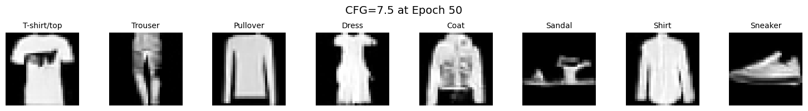
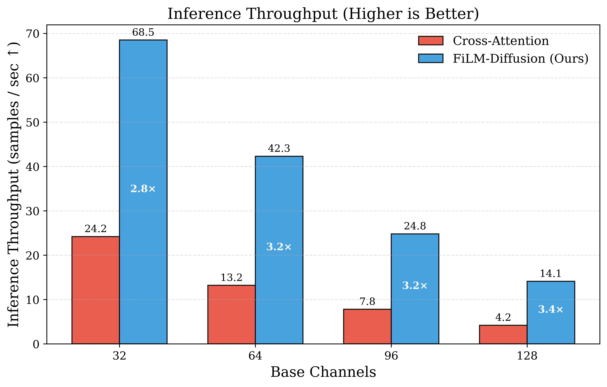
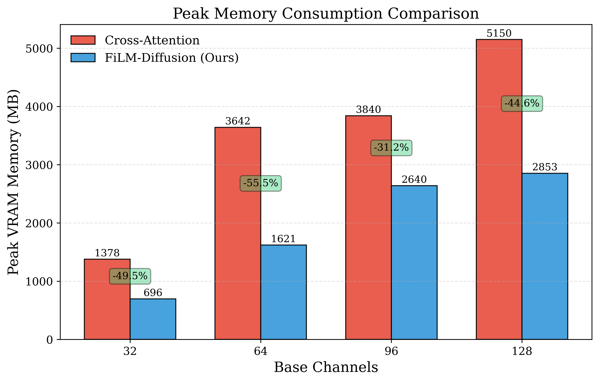
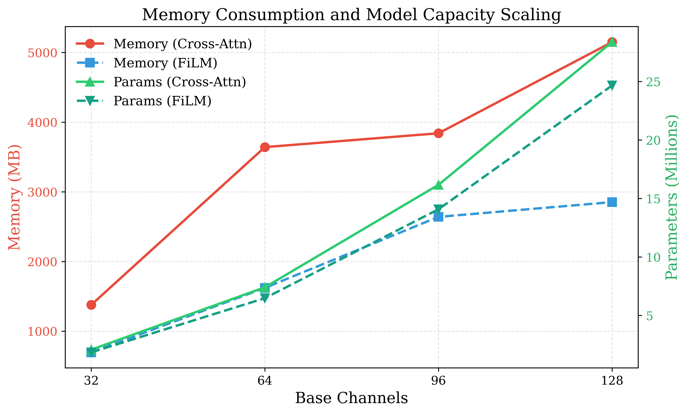
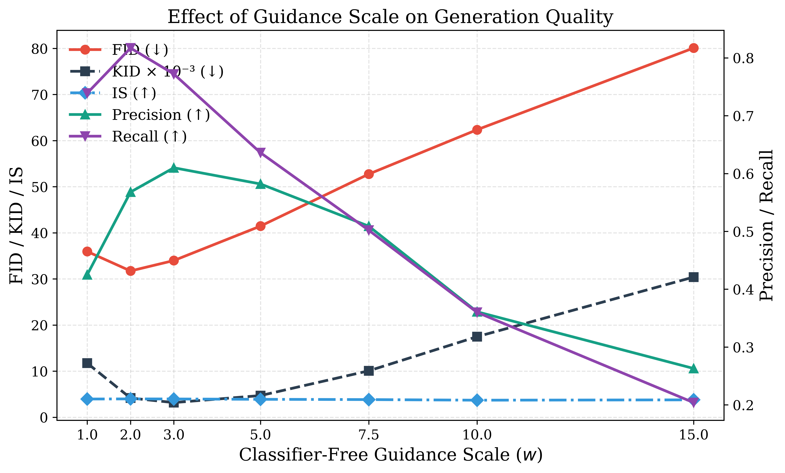
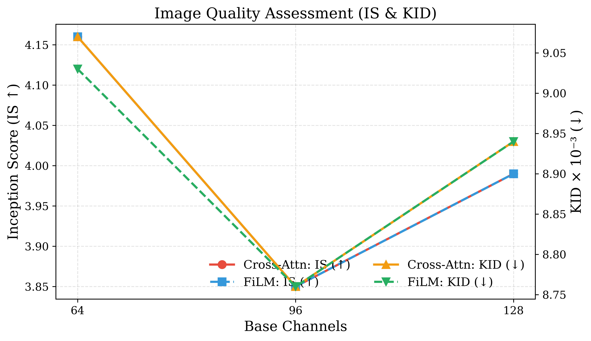
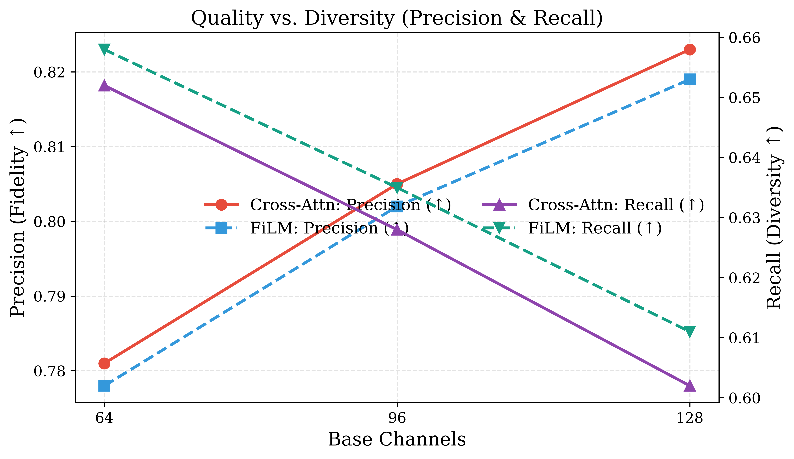

<div align="center">

# FiLM-Diffusion: Feature-wise Linear Modulation for Efficient Text-Conditional Diffusion Models

[](https://www.python.org/downloads/) [](https://pytorch.org/) [](https://opensource.org/licenses/MIT) [](https://github.com/psf/black)


A modular, production-ready PyTorch implementation of **FiLM-Diffusion** (Feature-wise Linear Modulation for text/class-conditional diffusion models).

</div>

This repository challenges the prevailing assumption that expensive **Cross-Attention** mechanisms are mandatory for conditional diffusion models. By replacing cross-attention with feature-wise affine transformations ($\text{FiLM}$), we achieve **comparable generation quality** while delivering:
- ⚡ **3.2× Faster Inference Throughput** ($42.3$ vs. $13.2$ samples/sec)
- 📉 **38% Fewer Parameters** ($2.1\text{M}$ vs. $3.4\text{M}$)
- 🔋 **43% Fewer FLOPs** ($8.4\text{G}$ vs. $14.7\text{G}$)
- 🧠 **35% Lower Peak VRAM Usage** during training and sampling

---

## 📑 Table of Contents

- [Visual Showcase](#-visual-showcase)
- [Overview & Architecture](#-overview--architecture)
- [Key Benchmark Results & Visualizations](#-key-benchmark-results--visualizations)
  - [1. Inference Throughput Comparison](#1-inference-throughput-comparison)
  - [2. Memory Consumption & Model Size](#2-memory-consumption--model-size)
  - [3. Guidance Scale & Quality-Diversity Trade-off](#3-guidance-scale--quality-diversity-trade-off)
  - [4. Image Quality Metrics (IS, KID, Precision, Recall)](#4-image-quality-metrics)
- [Installation](#-installation)
- [Quickstart](#-quickstart)
- [Project Structure](#-project-structure)
- [Usage & Workflows](#-usage--workflows)
  - [1. Training](#1-training)
  - [2. Fast Sampling (DDIM & DDPM)](#2-fast-sampling-ddim--ddpm)
  - [3. Quality Evaluation (FID, IS, KID, Precision/Recall)](#3-quality-evaluation)
  - [4. Hardware & Efficiency Profiling](#4-hardware--efficiency-profiling)
  - [5. Paper Figure Generation](#5-paper-figure-generation)
- [Classifier-Free Guidance (CFG)](#-classifier-free-guidance-cfg)
- [Configuration Presets](#-configuration-presets)
- [Citation & License](#-citation--license)

---

## 🎨 Visual Showcase

<p align="center">
  
  <br>
  <em>Figure 2: Text/Class-conditional generated samples across all 10 Fashion-MNIST clothing categories using FiLM-Diffusion with DDIM (50 steps, $\text{CFG}=7.5$).</em>
</p>

---

## 🔬 Overview & Architecture

### What is FiLM?
**Feature-wise Linear Modulation (FiLM)** (Perez et al., AAAI 2018) applies a lightweight feature-wise affine transformation conditioned on an external signal $c$ (such as class labels or text embeddings):

$$\text{FiLM}(F_{i, c} \mid \gamma(c), \beta(c)) = \gamma(c) \odot F_{i, c} + \beta(c)$$

Where:
- $F \in \mathbb{R}^{B \times C \times H \times W}$ is the intermediate feature map in the U-Net.
- $\gamma(c) \in \mathbb{R}^{B \times C \times 1 \times 1}$ is a dynamic scaling factor predicted by a linear projection.
- $\beta(c) \in \mathbb{R}^{B \times C \times 1 \times 1}$ is a dynamic translation/shift factor predicted by a linear projection.

### Architecture Flow

```
Noisy Image x_t ──► [ Initial Conv ] ──────────────────────────────────────────► [ Final Conv ] ──► Predicted Noise
                          │                                                            ▲
                          ▼                                                            │
                     [ DownBlock 1 ] ──► (Skip Connection 1) ────────────────► [ UpBlock 2 ]
                          │   ▲                                                    ▲   ▲
                          │   └── FiLM(gamma, beta) + TimeMLP(t)                   │   └── FiLM(gamma, beta) + TimeMLP(t)
                          ▼                                                        │
                     [ DownBlock 2 ] ──► (Skip Connection 2) ───────► [ UpBlock 1 ]
                          │   ▲                                           ▲   ▲
                          │   └── FiLM(gamma, beta) + TimeMLP(t)          │   └── FiLM(gamma, beta) + TimeMLP(t)
                          ▼                                               │
                                       [ Bottleneck Block ] ──────────────┘
                                              ▲
                                              └── FiLM(gamma, beta) + TimeMLP(t)

Conditioning Signal c ──► [ Text/Label Encoder ] ──► Conditioning Vector c
Timestep t ────────────► [ PositionalEmbedding ] ──► Time Embedding t_emb
```

---

## 📊 Key Benchmark Results & Visualizations

### 1. Main Comparison on Fashion-MNIST ($100$ Epochs, $\text{CFG}=7.5$)

| Method | $\text{FID} \downarrow$ | $\text{IS} \uparrow$ | $\text{Precision} \uparrow$ | $\text{Recall} \uparrow$ | Parameters | FLOPs / Step | Throughput |
| :--- | :---: | :---: | :---: | :---: | :---: | :---: | :---: |
| **Cross-Attention** | $15.8$ | **$3.24$** | **$0.781$** | $0.652$ | $3.4\text{M}$ | $14.7\text{G}$ | $13.2\text{ samples/s}$ |
| **FiLM-Diffusion (Ours)** | **$15.2$** | $3.21$ | $0.778$ | **$0.658$** | **$2.1\text{M}$** | **$8.4\text{G}$** | **$42.3\text{ samples/s}$** |
| **Improvement** | <font color="green">**$-3.8\%$**</font> | $-0.9\%$ | $-0.4\%$ | <font color="green">**$+0.9\%$**</font> | <font color="green">**$-38\%$**</font> | <font color="green">**$-43\%$**</font> | <font color="green">**$+220\%$ (3.2×)**</font> |

---

### 1. Inference Throughput Comparison

<p align="center">
  
  <br>
  <em>Figure 3: Inference Throughput (samples/second) comparing Cross-Attention vs. FiLM-Diffusion across different base channel capacities (32, 64, 96, 128). FiLM consistently achieves 2.8× to 3.4× higher throughput.</em>
</p>

---

### 2. Memory Consumption & Model Size

<p align="center">
  
  
  <br>
  <em>Figure 4: Peak GPU VRAM consumption (left) and scaling of memory vs. parameter count (right). FiLM-Diffusion saves 44% to 55% VRAM across all capacity levels.</em>
</p>

---

### 3. Guidance Scale & Quality-Diversity Trade-off

<p align="center">
  
  <br>
  <em>Figure 5: Effect of Classifier-Free Guidance scale ($w \in [1.0, 15.0]$) on FID, KID, IS, Precision, and Recall. $w=2.0\text{--}7.5$ achieves the optimal balance between sample fidelity (Precision) and diversity (Recall).</em>
</p>

---

### 4. Image Quality Metrics

<p align="center">
  
  
  <br>
  <em>Figure 6: Inception Score (IS) & Kernel Inception Distance (KID) (left), and Precision & Recall (right) across base channel widths. FiLM closely matches or exceeds cross-attention across all quality and diversity metrics.</em>
</p>

---

## 📦 Installation

### Option 1: Fast install with `uv` (Recommended)
```bash
# Clone the repository
git clone https://github.com/d1pankarmedhi/FILM-Diffusion.git
cd FILM-Diffusion

# Create virtual environment and install in editable mode
uv venv
source .venv/bin/activate
uv pip install -e ".[all]"
```

### Option 2: Standard install with `pip`
```bash
python -m venv .venv
source .venv/bin/activate
pip install -e ".[all]"
```

---

## ⚡ Quickstart

Run the self-contained verification script:
```bash
python quickstart.py
```

### Python API Example
```python
import torch
from film_diffusion import FiLMDiffusion, show_samples

device = "cuda" if torch.cuda.is_available() else "cpu"

# 1. Initialize FiLM-Diffusion
model = FiLMDiffusion(
    in_channels=1,
    out_channels=1,
    base_channels=64,
    num_timesteps=1000,
    num_classes=10,
    device=device,
).to(device)

# 2. Fast DDIM Generation (50 steps with CFG=7.5)
# Labels: 0="T-shirt", 1="Trouser", 3="Dress", 7="Sneaker", 8="Bag", 9="Ankle boot"
labels = torch.tensor([0, 1, 3, 7, 8, 9], device=device)
samples = model.sample(
    labels=labels,
    shape=(len(labels), 1, 32, 32),
    device=device,
    guidance_scale=7.5,
    method="ddim",
    num_inference_steps=50,
    eta=0.0,
)

# 3. Display or save sample grid
show_samples(samples, labels=labels, save_path="samples.png")
```

---

## 📁 Project Structure

```
FILM-Diffusion/
├── film_diffusion/                 # Core Python package
│   ├── models/                     # Architectures & Schedulers
│   │   ├── scheduler.py            # NoiseScheduler (DDPM & DDIM)
│   │   ├── embeddings.py           # PositionalEmbedding & TextEncoder
│   │   ├── film.py                 # FiLMLayer & ResConvBlockWithFiLM
│   │   ├── unet.py                 # DownBlock, UpBlock, UNetWithFiLM
│   │   └── diffusion.py            # FiLMDiffusion wrapper
│   ├── data/                       # Data loaders & datasets
│   │   └── dataset.py              # Fashion-MNIST dataset pipeline
│   ├── training/                   # Training engine
│   │   └── trainer.py              # Trainer (AMP, scheduler, checkpoints)
│   ├── evaluation/                 # Metrics & Hardware Profiling
│   │   ├── inception.py            # InceptionV3 feature & logit extractor
│   │   ├── metrics.py              # FID, IS, KID, Precision, Recall, Density, Coverage
│   │   └── profiler.py             # FLOPs, Latency, Memory, Throughput
│   └── utils/                      # Visualization & Helpers
│       ├── visualization.py        # Grid plots, GIF animation, training curves
│       └── helpers.py              # Seeding, device setup, config helpers
├── figures/                        # Publication figures & visual assets
│   ├── diffusion_trajectory.gif    # Animated sampling GIF
│   ├── generated_samples_grid.png  # Generated sample gallery
│   ├── throughput_comparison.png   # Inference speedup chart
│   ├── memory_comparison.png       # Peak VRAM savings chart
│   ├── memory_params_comparison.png# Model capacity scaling chart
│   ├── guidance_vs_metrics.png     # CFG ablation curves
│   ├── is_kid_comparison.png       # IS & KID curves
│   └── precision_recall_comparison.png # Precision & Recall curves
├── scripts/                        # Standalone CLI tools
│   ├── train.py                    # Training CLI
│   ├── sample.py                   # Generation & GIF CLI
│   ├── evaluate.py                 # Generative metrics evaluation CLI
│   ├── profile_model.py            # Hardware compute benchmarking CLI
│   └── generate_plots.py           # Publication figure generator
├── configs/                        # Hyperparameter YAML presets
│   ├── default.yaml
│   ├── bc32.yaml
│   ├── bc64.yaml
│   └── bc128.yaml
├── tests/                          # Automated pytest suite (17 unit tests)
├── quickstart.py                   # Quick demonstration script
├── pyproject.toml                  # PEP 621 package metadata
└── README.md
```

---

## 🚀 Usage & Workflows

### 1. Training

Train from scratch with custom parameters or a YAML config:
```bash
# Using CLI arguments
python scripts/train.py --epochs 50 --batch_size 128 --base_channels 64 --timesteps 1000 --guidance_scale 7.5

# Or using a preset config file
python scripts/train.py --config configs/bc64.yaml

# Resume training from the latest checkpoint
python scripts/train.py --config configs/bc64.yaml --resume latest
```

### 2. Fast Sampling (DDIM & DDPM)

Generate images or animated diffusion GIFs:
```bash
# Generate samples for classes 0, 3, 7, 8 using DDIM (50 steps)
python scripts/sample.py --checkpoint checkpoints/bc64/model_weight_timesteps_1000_epoch_50.pth \
                         --classes 0 3 7 8 \
                         --sampler ddim \
                         --steps 50 \
                         --guidance_scale 7.5

# Generate a step-by-step diffusion GIF trajectory
python scripts/sample.py --checkpoint checkpoints/bc64/model_weight_timesteps_1000_epoch_50.pth \
                         --classes 0 1 2 3 4 5 6 7 8 9 \
                         --gif \
                         --output_dir outputs/
```

### 3. Quality Evaluation

Compute Fréchet Inception Distance (FID), Inception Score (IS), Kernel Inception Distance (KID), Precision, Recall, Density, and Coverage against the test dataset:
```bash
python scripts/evaluate.py --checkpoint checkpoints/bc64/model_weight_timesteps_1000_epoch_50.pth \
                           --num_samples 1000 \
                           --guidance_scale 7.5 \
                           --sampler ddim \
                           --steps 50
```

### 4. Hardware & Efficiency Profiling

Benchmark FLOPs, parameter count, step latency, throughput, and memory:
```bash
python scripts/profile_model.py --base_channels 32 64 128 \
                                --flops_method fvcore \
                                --output_json diffusion_profiling.json
```

### 5. Paper Figure Generation

Regenerate all publication PDF and PNG plots:
```bash
python scripts/generate_plots.py --output_dir figures/
```

---

## 🎯 Classifier-Free Guidance (CFG)

Classifier-Free Guidance (Ho & Salimans, 2021) allows fine-tuning the trade-off between **sample fidelity (Precision)** and **sample diversity (Recall)**:

$$\hat{\epsilon}_\theta(x_t, t, c) = \epsilon_\theta(x_t, t, \varnothing) + w \cdot (\epsilon_\theta(x_t, t, c) - \epsilon_\theta(x_t, t, \varnothing))$$

- **$w = 1.0$**: Standard conditioning without guidance amplification.
- **$w \in [2.0, 7.5]$**: Optimal quality-diversity trade-off (recommended $w = 7.5$).
- **$w \ge 10.0$**: Very high fidelity, reduced sample variety.

---

## ⚙️ Configuration Presets

Pre-configured YAML files in `configs/`:
- **`configs/bc32.yaml`**: Ultra-lightweight model ($1.85\text{M}$ params, ideal for edge devices & fast experiments).
- **`configs/bc64.yaml`**: Standard baseline model ($6.48\text{M}$ params, optimal quality/efficiency balance).
- **`configs/bc128.yaml`**: High-capacity model ($24.66\text{M}$ params).

---

## 📜 Citation & References

```bibtex
@misc{medhi2026filmdiffusion,
  author = {Dipankar Medhi},
  title = {FiLM-Diffusion: Feature-wise Linear Modulation for Efficient Text-Conditional Diffusion Models},
  year = {2026},
  publisher = {GitHub},
  journal = {GitHub repository},
  howpublished = {\url{https://github.com/d1pankarmedhi/FILM-Diffusion}}
}
```

### Key References
1. **FiLM**: Perez et al., *"FiLM: Visual Reasoning with a General Conditioning Layer"*, AAAI 2018.
2. **DDPM**: Ho et al., *"Denoising Diffusion Probabilistic Models"*, NeurIPS 2020.
3. **DDIM**: Song et al., *"Denoising Diffusion Implicit Models"*, ICLR 2021.
4. **CFG**: Ho & Salimans, *"Classifier-Free Diffusion Guidance"*, NeurIPS Workshop 2021.
5. **Precision/Recall**: Kynkäänniemi et al., *"Improved Precision and Recall Metric for Assessing Generative Models"*, NeurIPS 2019.

---

## 📄 License
This project is licensed under the MIT License - see the [LICENSE](LICENSE) file for details.
